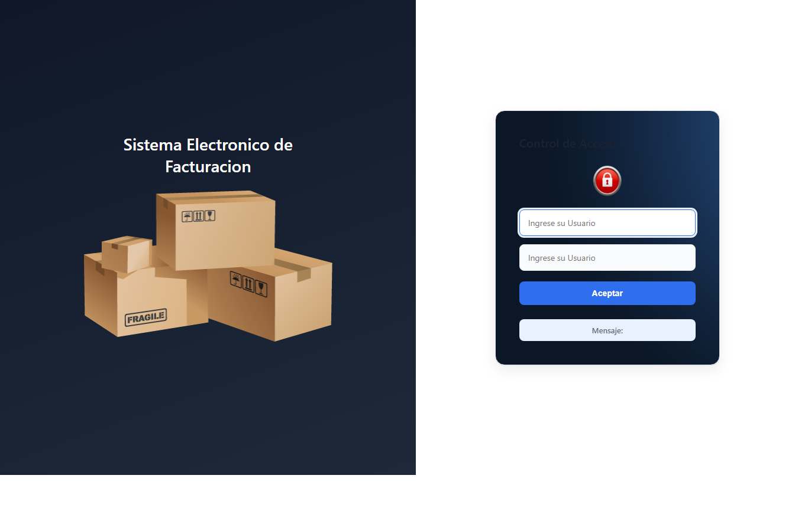
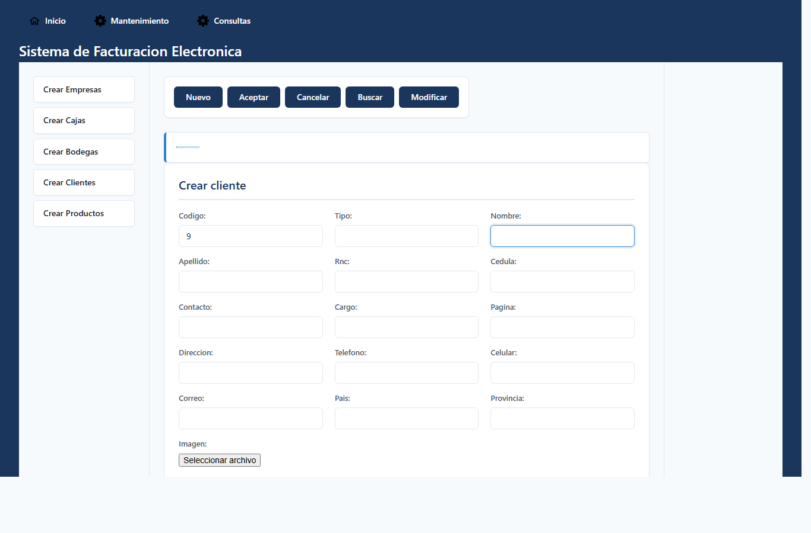
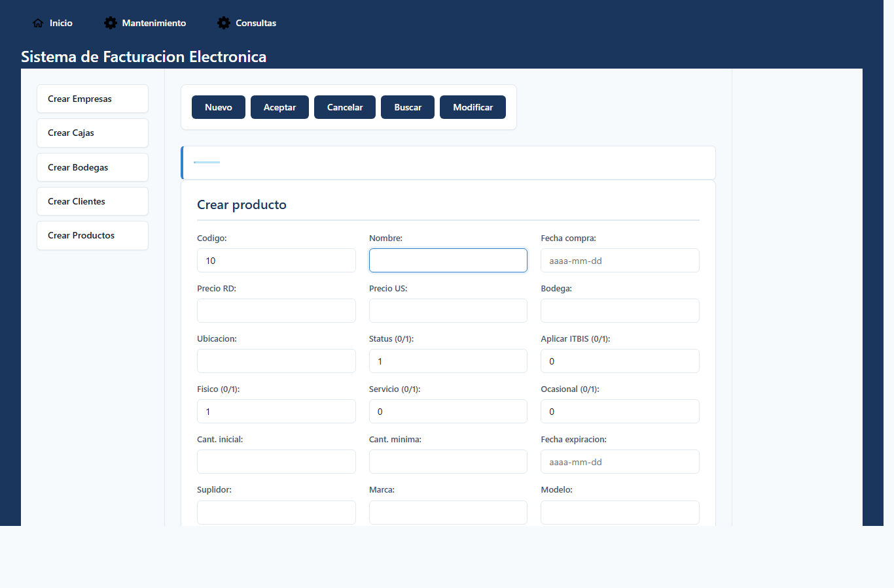
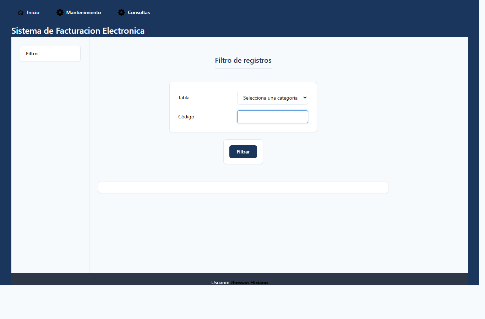

# Sistema de Facturación

Aplicación web para la gestión de facturación y mantenimiento de datos comerciales,
desarrollada con **ASP.NET WebForms** y **SQL Server**. Incluye mantenedores,
consultas filtrables y una interfaz corporativa responsive.

## Tecnologías

| Capa | Tecnología |
|---|---|
| Frontend | ASP.NET WebForms, Master Pages, CSS Grid/Flexbox |
| Backend | C# (.NET Framework 4.7.2), ADO.NET |
| Base de datos | SQL Server Express, Stored Procedures |
| Servidor | IIS Express / IIS |
| Control de versiones | Git |

## Funcionalidades

- **Mantenedores** de Cliente, Producto, Caja, Bodega y Empresa: alta, modificación
  y consulta desde grilla con selección de fila.
- **Consulta Filtro**: página independiente que busca un registro por código en
  cualquier tabla. La columna de código se deriva de las primeras tres letras de la
  tabla + `_codigo` (ej. `cli_codigo`, `pro_codigo`).
- **Validación de duplicados** antes de insertar o modificar (RNC en Cliente,
  nombre en Producto), excluyendo el registro que se está editando.
- **Diseño corporativo claro**, sin fuentes externas, con botones que se ajustan
  y grillas con scroll interno.

## Capturas

**Inicio de sesión**



**Mantenimiento de clientes**



**Mantenimiento de productos**



**Consulta por filtro**



## Estructura del proyecto

```
SistemaElectronico/
├── AppThemes/Principal/Principal.css   # tema corporativo y layout
├── Clases/ConexionDB.cs                # Singleton de conexión
├── Consultas/
│   ├── formFiltro.aspx                 # búsqueda genérica por código
│   └── MpConsultas.master              # master de consultas
├── Database/
│   ├── Cliente_SP.sql                  # SPs de Cliente corregidos
│   └── Producto_SP.sql                 # SPs de Producto corregidos
├── Login/                              # acceso al sistema
├── Mantenimiento/
│   ├── formClientes.aspx
│   ├── formProductos.aspx
│   ├── formCaja.aspx
│   ├── formBodega.aspx
│   └── formEmpresa.aspx
├── docs/captures/                      # imágenes del README
└── Web.config
```

## Requisitos

- Visual Studio 2022 con la carga de desarrollo web ASP.NET
- .NET Framework 4.7.2 Developer Pack
- SQL Server Express (instancia `SQLEXPRESS`) con autenticación de Windows
- Git

## Instalación y ejecución

1. Clonar el repositorio:
   ```bash
   git clone https://github.com/JhozzDev/Sistema-de-Facturacion.git
   ```
2. Abrir `SistemaElectronico.sln` en Visual Studio 2022.
3. Crear la base de datos `Sistema` en SQL Server Express (o restaurar el backup).
4. Ejecutar los scripts de `SistemaElectronico/Database/` en este orden:
   `Cliente_SP.sql` → `Producto_SP.sql`.
5. Revisar la cadena de conexión en `Clases/ConexionDB.cs` (método `CrearConexion`).
   Por defecto apunta a `localhost\SQLEXPRESS`, base `Sistema`, con
   `Trusted_Connection=True`.
6. Compilar con `Ctrl+Shift+B` y ejecutar con **F5** (IIS Express).

> Nota: la cadena de conexión está actualmente en código; está previsto moverla
> a `Web.config`.

## Base de datos

16 tablas: `bodega`, `caja`, `categoria`, `cliente`, `color`, `empresa`, `login`,
`marca`, `medidas`, `modelo`, `pais`, `producto`, `provincia`, `subcategoria`,
`tiposclientes`, `ubicacion`.

Convenciones:
- Columna de código: primeras 3 letras de la tabla + `_codigo`.
- Procedimientos: `sp_Insert_<Entidad>`, `sp_Update_<Entidad>`,
  `sp_Consulta_Grid<Entidad>`, `sp_RegistroExiste_<Entidad>`,
  `sp_ContarRegistro_<Entidad>`.

## Decisiones técnicas

- **Stored Procedures** para la persistencia: separan SQL del código y permiten
  validar duplicados en el servidor.
- **Parámetros tipados** (`SqlDbType`, `Precision`/`Scale`) en lugar de
  `AddWithValue`, evitando conversiones implícitas.
- **Singleton** en `ConexionDB.getInstancia()` para centralizar las conexiones.
- **`using`** en conexiones, comandos y readers: liberación determinista.
- **Master Pages** para compartir cabecera, menú y estilos entre módulos.
- **CSS Grid** para formularios de muchas columnas y `overflow` interno en el
  GridView para evitar desbordes.

## Problemas resueltos

| Módulo | Problema | Solución |
|---|---|---|
| Cliente | `sp_Update_Cliente` no guardaba apellido/cédula ni tipo | SP corregido y versionado |
| Cliente | Validación de RNC rechazaba el propio registro al editar | SP que excluye el código actual |
| Producto | `sp_Update_Producto` asignaba `pro_servicio = @pro_fisico` | SP reescrito |
| Producto | El formulario era una copia de Empresa | 28 campos reales + grilla |
| Producto | Decimales `1,00` / `1.25` se guardaban mal | Normalización antes de parsear |
| Layout | Botones y grillas desbordaban la pantalla | Contenedores con wrap y scroll |

## Mejoras futuras

- Mover la cadena de conexión a `Web.config` (seguridad).
- Reemplazar la exportación CSV por un `.xlsx` integrado en la interfaz
  (ClosedXML/EPPlus).
- Extraer la lógica de datos a una capa Repository con inyección de dependencias.
- Sanitizar el nombre de tabla del Filtro con una lista blanca.
- Agregar pruebas unitarias.

## Autor

Cristian Hiciano
